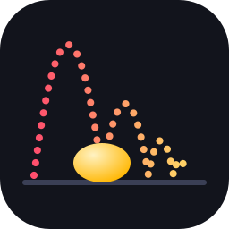

# Anime Kinetix for Codex



Anime Kinetix is a Codex plugin and browser playground for creating editable web motion. Use **Anime.js** for scripted animations and **Matter.js** for 2D scenes whose motion comes from gravity and collisions. Generate a complete HTML file in Codex or tune and preview it in the browser.

| Engine | Available scenes | Controls |
| --- | --- | --- |
| Anime.js 4.5.0 | Slide in, pulse, staggered entrance, orbit | Preset, duration, easing, stagger delay, loop |
| Matter.js 0.20.0 | Bouncing circles and squares | Gravity, bounciness, shape count, play, pause, reset |

The Codex tools and local preview run with Node.js 22 or newer. The local preview uses the libraries bundled in this repository. Exported HTML loads the selected engine from a version-pinned jsDelivr URL and needs internet access on first load.

## Install in Codex

Install [Node.js 22 or newer](https://nodejs.org/) and make sure `node --version` works in the environment where Codex runs. With a Codex CLI that supports plugins, run:

```sh
codex plugin marketplace add https://github.com/zedalleys/anime-kinetix-codex-plugin
codex plugin add anime-kinetix-codex-plugin@anime-kinetix
```

Open a new Codex session and try:

- “Create an 800 ms staggered entrance with 100 ms between tiles. Save it as `entrance.html`.”
- “Make 8 shapes bounce with gravity 1.2 and bounciness 0.8. Save the editable scene as `bounce.html`.”
- “List the available animation and physics presets.”

To install from a checkout, pass its absolute path to `codex plugin marketplace add` in place of the GitHub URL. Use `codex plugin list --marketplace anime-kinetix` to check installation.

## Run the browser playground

```sh
git clone https://github.com/zedalleys/anime-kinetix-codex-plugin.git
cd anime-kinetix-codex-plugin
npm run preview
```

Open [the local playground](http://127.0.0.1:4179). Choose an engine, adjust its settings, and select **Update preview**. Once the preview reflects your changes, **Copy HTML** copies the source and **Download HTML** saves it. Open the exported file in a browser or edit the settings and styles in a text editor.

Use `ANIME_KINETIX_PORT=4180 npm run preview` if port 4179 is already in use. The preview binds to loopback.

### Playback and reduced motion

The playground and exported examples respect the browser's reduced-motion preference at startup. Use **Play** to start explicitly. In Matter.js scenes, **Pause** freezes the scene, **Play** resumes it, and **Reset** returns all shapes to their starting positions and pauses playback. Anime.js previews offer **Play** to restart and **Pause/Resume** during playback.

## Codex tool reference

The plugin registers a local MCP server named `anime-kinetix`. It uses standard input and output and starts with Codex. Each generator returns an HTML document as text. Ask Codex to save that text to a file if you want a file in your workspace.

### Anime.js

`list_animation_presets` takes no arguments and returns the available presets, supported settings, and defaults.

`generate_animation_html` accepts:

| Setting | Values | Default |
| --- | --- | --- |
| `preset` | `slide-in`, `pulse`, `stagger`, `orbit` | `stagger` |
| `duration` | Integer from 150 to 3000 ms, per element | `850` |
| `ease` | `linear`, `outCubic`, `inOutSine`, `outBack`, `outElastic` | `outCubic` |
| `stagger` | Integer from 0 to 500 ms, used by the stagger preset | `90` |
| `loop` | Boolean | `false` |

```json
{
  "preset": "stagger",
  "duration": 800,
  "ease": "outCubic",
  "stagger": 100,
  "loop": false
}
```

### Matter.js

`list_physics_presets` takes no arguments and returns the engine version, the bouncing-shapes scene, supported settings, and defaults.

`generate_physics_html` accepts:

| Setting | Values | Default |
| --- | --- | --- |
| `gravity` | Number from 0 to 2. At 0, shapes keep their initial motion without falling. | `1` |
| `restitution` | Number from 0 to 0.95. Larger values increase bounce. | `0.75` |
| `count` | Integer from 2 to 12 | `6` |

```json
{
  "gravity": 1.2,
  "restitution": 0.8,
  "count": 8
}
```

Omitted settings use their defaults. Generator calls return an error for unknown fields, invalid types, or values outside the supported range.

## Extend the plugin

| Path | Purpose |
| --- | --- |
| `page.html` | Browser controls, embedded preview, and copy/download actions |
| `dist/server/motion.js` | Anime.js preset schemas and HTML generator |
| `dist/server/physics.js` | Matter.js scene schema, simulation, and HTML generator |
| `dist/server/mcp.js` | Shared MCP tool definitions, validation errors, and dispatch |
| `dist/server/index.js` | Worker entry point for the web playground and its HTTP MCP endpoint |
| `server/stdio.js` | Codex stdio entry point |
| `skills/anime-kinetix/SKILL.md` | Codex workflow guidance |
| `build.mjs` | Embeds browser assets and engine bundles in the Site worker |
| `test/plugin.test.js` | Tests both transports, tool discovery, HTML generation, and invalid inputs |

Run `npm test` to rebuild the embedded assets and run the tests. Run `npm run build` after changing browser assets before committing the generated worker assets. The source tree includes the existing Sites configuration. Pushing source to GitHub and deploying a new version of the hosted playground are separate operations.

For new physics scenes, keep the tool schema and browser controls in sync. The current scene advances Matter.js in fixed 60 Hz steps, caps catch-up after an inactive tab, and uses each body's coordinates and angle to place its SVG shape. For a hybrid scene, let Matter.js own the positions and angles of colliding bodies. Use Anime.js for scripted properties such as interface transitions, opacity, and color.

## Troubleshooting

| Symptom | What to check |
| --- | --- |
| Codex does not show the tools | Verify Node.js is available on Codex's PATH, check the marketplace listing, and start a new session. |
| The preview server reports that its port is in use | Start it with a different `ANIME_KINETIX_PORT`. |
| A preview loads in a paused state | Check the system/browser reduced-motion preference and select **Play** if you want to start it. |
| Copy fails | Use **Download HTML**, which works without clipboard access. |
| An exported demo cannot load its engine | Check internet/CDN access, or download the pinned engine and update the HTML to use your own hosted copy. |

## Roadmap and library choices

**Matter.js is the best immediate addition.** It adds gravity, collisions, and emergent motion to the existing browser and HTML export workflow. **PixiJS is the next choice** when scenes need many particles, richer effects, or a high-throughput renderer. **Tone.js** fits when a preset needs synchronized sound or synthesized impact effects. Start audio only after the viewer chooses to enable it.

| Project | Fit for Anime Kinetix |
| --- | --- |
| [Anime.js](https://github.com/juliangarnier/anime) | Core engine for scripted UI or DOM motion, easings, and timelines. |
| [Matter.js](https://github.com/liabru/matter-js) | Integrated for rigid-body physics. Constraints and additional scenes fit the same workflow. |
| [PixiJS](https://github.com/pixijs/pixijs) | Next renderer for particles, filters, or dense sprites. Matter.js can continue to supply physics coordinates. |
| [Tone.js](https://github.com/Tonejs/Tone.js) | Optional browser audio for sound cues, beats, and synchronized effects. |
| [react-spring](https://github.com/pmndrs/react-spring) | Useful for a React-specific motion export target, with overlap in the current playback workflow. |
| [p5.js](https://github.com/processing/p5.js) | Useful for a dedicated generative-art or sketch workflow. |
| [D3](https://github.com/d3/d3) | Useful for animated charts and data-driven motion presets. |
| [OpenToonz](https://github.com/opentoonz/opentoonz) | Desktop animation studio suited to a separate asset-authoring workflow. |
| [Hunyuan3D-2](https://github.com/Tencent-Hunyuan/Hunyuan3D-2) | 3D asset generation for a separate model pipeline. |
| [TRELLIS](https://github.com/microsoft/TRELLIS) | Another option for generating 3D assets in a separate inference workflow. |
| [LTX-2](https://github.com/Lightricks/LTX-2) | Audio/video generation that would need a separate inference and media workflow. |
| [LivePortrait](https://github.com/KwaiVGI/LivePortrait) | Portrait animation for a dedicated image/video workflow. |
| [RIFE](https://github.com/hzwer/ECCV2022-RIFE) | Frame interpolation for a future rendered-video export workflow. |
| [MusicGen](https://github.com/facebookresearch/audiocraft) | Generated soundtracks for a future media workflow. Check the model-weight license for the intended use. |

Open-source availability does not make model inference or hosting cost-free. GPU requirements and model-weight licenses vary by project.

## Related project and third-party licenses

The [Claude plugin](https://github.com/zedalleys/anime-kinetix-claude-plugin) is the companion for Claude Code.

The bundled runtimes are distributed under their respective MIT licenses. See the [Anime.js license](vendor/LICENSE.md) and the [Matter.js license](vendor/Matter.js-LICENSE).
